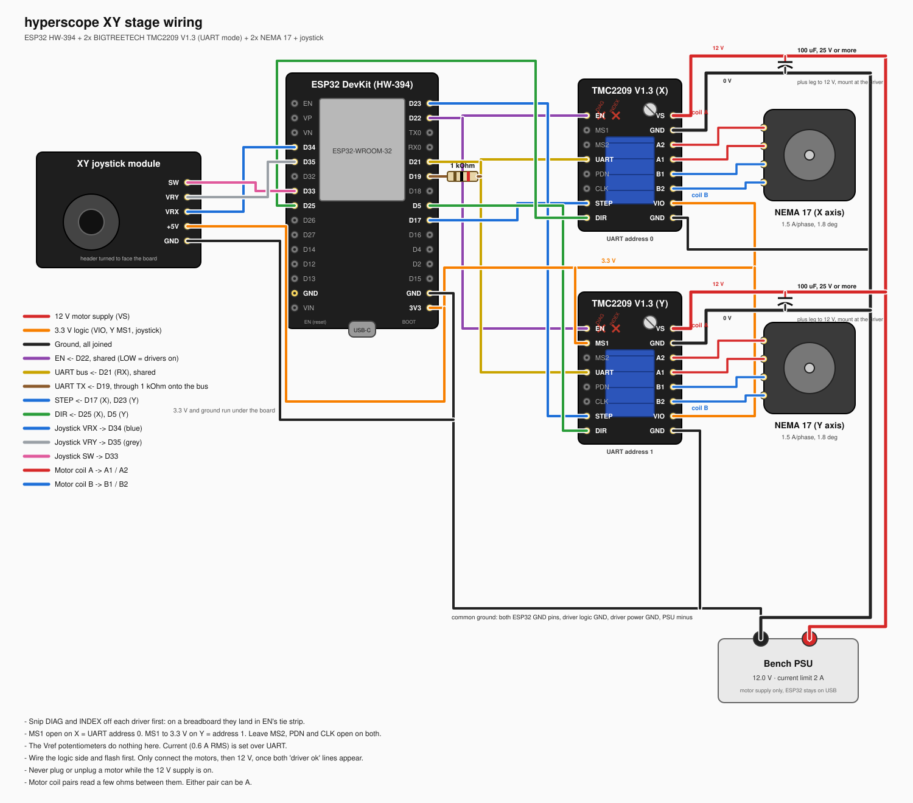

# XY stage hardware

Two NEMA 17 steppers turn the microscope's X (left/right) and Y (up/down) stage knobs through 3D-printed mounts. An ESP32 drives them through two TMC2209 drivers and takes commands over USB serial, with an analog joystick for manual jogging. Firmware lives in `firmware/hyperscope_stage/`; the pin map there (`config.h`) is the source of truth and this document mirrors it.

## Bill of materials

| Part | Detail | Notes |
|------|--------|-------|
| 2x NEMA 17 stepper | MVPower, 1.5 A/phase, 1.8°, 4-wire | Run at 800 mA RMS in firmware (rated 1.5 A peak = ~1.06 A RMS) |
| ESP32 DevKit | HW-394, 30-pin DOIT DevKit V1 layout, USB-C | Powered from Mac USB; pins labelled D<n> = GPIO n |
| 2x TMC2209 | BIGTREETECH V1.3 (V1.2 docs in `datasheets/`) | UART mode, 0.11 Ω sense. V1.3 silkscreen says **VS** for VM and **VIO** for VDD |
| Bench PSU | Set to **12 V**, ≥ 2 A | Motor supply only |
| XY joystick | 5 V type, pins GND/+5V/VRX/VRY/SW | **Power from 3V3**, not 5 V |
| 2x 100 µF electrolytic, ≥ 25 V | Across VM/GND at each driver | Absorbs motor back-EMF |
| 1x 1 kΩ resistor | ESP32 TX → UART bus | Single-wire UART |
| Heatsinks for TMC2209 | Included with drivers | Do not let them touch pins |

## Power

- **Motor supply (VM)**: 12 V from the PSU to VM and GND on both drivers. Star the two drivers from the PSU terminals; do not daisy-chain through thin dupont wire.
- **Logic**: ESP32 from USB. Each driver's VDD (VCC_IO) pin from the ESP32 **3V3** pin. This sets the driver's IO level to 3.3 V so its UART replies do not overdrive the ESP32.
- **Common ground**: PSU GND, driver GND, and ESP32 GND must all be joined.
- **Sequencing**: plug the motors into the drivers first, then power the PSU. Never connect or disconnect a motor while VM is live. Set the PSU current limit to 2 A on first power-up.

## Wiring diagram



The diagram shows the original hand-wired breadboard build. Its pins and UART addresses differ from the carrier PCB; for the PCB, the pin map below and `config.h` are authoritative.

`docs/diagrams/wiring.svg` is generated by `docs/diagrams/make_wiring_diagram.py`; edit the script, not the SVG. A PNG render sits beside it. Re-render with headless Brave:

```bash
uv run python docs/diagrams/make_wiring_diagram.py
"/Applications/Brave Browser.app/Contents/MacOS/Brave Browser" --headless --disable-gpu --hide-scrollbars \
  --window-size=1500,1320 --screenshot="$PWD/docs/diagrams/wiring.png" "file://$PWD/docs/diagrams/wiring.svg"
```

## Carrier PCB

The DevKit and the driver modules plug into a carrier PCB. KiCad sources, Gerbers, the generator script, and fabrication settings live in [`hardware/pcb/README.md`](../hardware/pcb/README.md). The breadboard notes below are for bench debugging.

## Breadboard placement

The driver is 0.6" wide, so it straddles the centre trench like a wide DIP. Two extra pins stand on the short edge beside the potentiometer, soldered and pointing down like the main headers: **DIAG** and **INDEX**. The bare plated hole between them is the Vref test point and carries no pin. Both pins are driver outputs, and neither is used here.

**Snip or desolder DIAG and INDEX before fitting the module.** They sit on the same line as EN, one and two tenths of an inch inboard, and a breadboard tie strip is five holes long, so there is no seating position that works:

| Seating | Result |
|---------|--------|
| EN row in an outer column | DIAG and INDEX drop into EN's own tie strip |
| EN row in the column beside the trench | DIAG and INDEX hit the solid trench floor and the module cannot seat |

Bridging them is not an option. EN is an input driven by the ESP32, while DIAG and INDEX are push-pull outputs, so shorting the three makes two outputs fight the microcontroller. INDEX also pulses once per electrical cycle, which would toggle EN and cut the driver out mid-move. BIGTREETECH's own note (`datasheets/btt-tmc2209-diag-pin-note.pdf`) says to cut the DIAG pin whenever the function is unused.

Cutting DIAG costs only the hardware stall line. StallGuard still works over UART through `SGTHRS` and `SG_RESULT`, which is fast enough to home a microscope stage.

With those two pins gone, seat the module so the **EN/STEP/DIR row is in an outer column**. Run the 12 V supply into the board's power rails, put the 100 µF capacitor across the rails, and jumper VS and GND from there.

Breadboard contacts are rated around 1 A. That is fine for bench testing at 1 A RMS with short solid-core wires, but move to a soldered board before leaving the stage running unattended.

## Pin map

### ESP32 to TMC2209

The driver signals sit on the DevKit's 3V3-side row in the same left-to-right order as the module header. With the USB-C out of the left board edge that row is the lower one, nearest the board edge, and the traces pass under the DevKit.

"X driver" and "Y driver" below are the PCB socket labels. The firmware names axes after the stage instead: the board's Y socket drives stage X (left/right, +X right) and its X socket drives stage Y (up/down, +Y up). The swap lives in the pin and address constants in `config.h`.

| Signal | X driver | Y driver | ESP32 | Notes |
|--------|----------|----------|-------|-------|
| EN | EN | EN | D4 (shared) | Active low. The module pulls EN low (20 kΩ) and GPIO 4 has a weak internal pull-down at reset, so the PCB adds a 2.2 kΩ pull-up to 3V3 (about 2.85 V, above the driver's 2.3 V threshold); otherwise both drivers are enabled at pot current while D4 floats during boot |
| PDN_UART (header pin 4) | PDN | PDN | D17 direct, D16 via 1 kOhm | Both drivers on one wire, one resistor |
| STEP | STEP | | D5 | Strapping pin, sampled only at reset |
| DIR | DIR | | D18 | |
| STEP | | STEP | D19 | |
| DIR | | DIR | D21 | |
| DIAG | DIAG | | D13 | Via 1 kOhm and a solder jumper on the PCB, see below |
| DIAG | | DIAG | D22 | |
| Motor LED | D2 (blue) | | D32 | Via 100 Ohm, lit while this socket's motor (stage Y) moves |
| Motor LED | | D3 (blue) | D23 | Via 100 Ohm, lit while this socket's motor (stage X) moves |
| VDD (marked **VIO** on V1.3) | 3V3 | 3V3 | 3V3 | Sets the driver's logic level |
| GND (logic side) | GND | GND | GND | |
| MS1 | 3V3 | GND | | UART address: X = 3, Y = 2. Solder jumpers on the PCB; from the back, GND is the left pad |
| MS2 | 3V3 | 3V3 | | |
| CLK, PDN (pin 5) | open | open | | |
| INDEX | open | open | | |

The BTT board connects UART to header pin 4 from the factory (manual §8.1). Pin 5 is a second PDN pad that is not connected; leave it alone. In UART mode the MS1/MS2 pins stop selecting microsteps and become the address bits, and firmware sets 16 microsteps and current over UART. The Vref potentiometer is ignored (`I_scale_analog = 0`).

**DIAG jumper.** The module's two extra pins beside EN are DIAG and INDEX, and which is which was not confirmed from the module photos. Each socket has a three-pad solder jumper on the back of the PCB: move a motor, probe which of the two pads pulses (that one is INDEX), then bridge the centre pad to the other one.

### Single-wire UART detail

```
ESP32 GPIO16 (TX) ──[1 kΩ]──┬── PDN_UART (X driver)
ESP32 GPIO17 (RX) ──────────┤
                            └── PDN_UART (Y driver)
```

The resistor lets the driver pull the line while the ESP32 TX is idle high.

### Motors

| Driver pin | Motor wire |
|------------|------------|
| A2, A1 | Coil A pair |
| B1, B2 | Coil B pair |

Find the pairs with a multimeter: the two wires of one coil read a few ohms between them, and open to the other pair. Which pair is "A" does not matter. Swapping the two wires of one coil reverses direction; flip `DIR_INVERT_X/Y` in `config.h` instead of rewiring.

### Joystick

| Joystick pin | ESP32 |
|--------------|-------|
| GND | GND |
| +5V | **3V3** |
| VRX | D34 |
| VRY | D35 |
| SW | D33 (internal pull-up) |

On the PCB the joystick plugs into a 1x5 pin header with dupont leads, with a 100 nF filter on each axis.

D34 and D35 are input-only ADC1 pins with no pull-ups, which is why SW goes to D33 instead.

### Pins to avoid on this board

GPIO 0, 2, 12, 15 are boot-strapping pins; GPIO 6–11 are the flash; GPIO 1/3 are the USB serial. None of them are used above. GPIO 5 is also sampled at reset, but only for SDIO timing, and a STEP line there is harmless because the drivers are disabled until the firmware enables them.

## Firmware

Core `esp32:esp32` 3.3.12, libraries `TMCStepper` 0.7.3 and `FastAccelStepper` 2.0.0. Board FQBN `esp32:esp32:esp32`.

```bash
arduino-cli core install esp32:esp32
arduino-cli lib install TMCStepper FastAccelStepper
```

Using the `arduino` alias from `arduino-cli-tool`:

```bash
arduino run --path firmware/hyperscope_stage
```

or directly:

```bash
arduino-cli compile --fqbn esp32:esp32:esp32 firmware/hyperscope_stage
arduino-cli upload  --fqbn "esp32:esp32:esp32:UploadSpeed=115200" -p /dev/cu.usbserial-XXXX firmware/hyperscope_stage
arduino-cli monitor -p /dev/cu.usbserial-XXXX -c baudrate=115200
```

The default upload speed of 921600 baud makes this board's CH340 drop out partway through with "The chip stopped responding". Pinning `UploadSpeed=115200` is slower but reliable.

### Driver settings applied at boot

| Setting | Value | Why |
|---------|-------|-----|
| RMS current | 800 mA per axis, hold 25 % | Below the motor's ~1060 mA RMS rating. Enough for the lubricated stage; an unlubricated one stalled the vertical axis even at 1200 mA. Set per axis in `config.h`; fanless BTT modules are fine to ~1.2 A RMS |
| Microsteps | 16 (3200/rev) | Smooth, and FastAccelStepper handles the step rate easily |
| Chopper | StealthChop, PWM at 47 kHz | Silent; the default 35 kHz gave an audible whirr at standstill |

### Serial protocol

115200 baud, newline-terminated, case-insensitive. Every command answers `ok` or `err <reason>`. After a reset no axis is zeroed, so moves are refused until `ZERO` or `HOME` (or `LIMITS 0`). Lines starting with `#` are informational.

| Command | Effect |
|---------|--------|
| `?` | Print position, motion state, settings, and each driver's microsteps and current read back over UART |
| `MOVE X<n> Y<n>` | Relative move in microsteps; either axis optional |
| `GOTO X<n> Y<n>` | Absolute move in microsteps |
| `JOG X<hz> Y<hz>` | Run at a signed velocity in microsteps/s until the next command; 0 stops that axis. Used by `stage_control.py jog` |
| `ZERO` | Set current position as origin and mark both axes zeroed |
| `MIN X<n> Y<n>` / `MAX X<n> Y<n>` | Soft limits in microsteps. Moves and jogs stop at them. Default ±3200 (one knob turn) until measured |
| `LIMITS <0/1>` | Turn soft limits and the zeroed check on or off. Off at boot until the travel is measured (`LIMITS_ENABLED_AT_BOOT`) |
| `SGTEST X<hz>` | Run briefly at a signed speed and print StallGuard's `SG_RESULT` range, for choosing a threshold |
| `SGT X<n> Y<n>` | Stall threshold, 0..255. A stall is `SG_RESULT <= 2 x SGT`, so higher is more sensitive |
| `HOME X<hz>` | Run toward the stop on the sign's side until StallGuard reports a stall, zero there, back off 800 steps |
| `STOP` | Decelerate to a stop |
| `HALT` | Stop immediately |
| `SPEED <hz>` | Max speed in microsteps/s for serial moves |
| `ACCEL <hz/s²>` | Acceleration |
| `EN <0/1>` | Disable or enable drivers (motors turn freely when disabled) |
| `JOY <0/1>` | Disable or enable joystick jogging |
| `CUR <mA>` | Set RMS current on both drivers, 100 to 1500 |
| `JOYRAW` | Raw joystick readings and the jog speeds they produce |
| `DIRTEST [X\|Y]` | Step each way and read that driver's counter to verify STEP and direction (default X) |
| `JOYCAL` | Re-measure the joystick's resting centre |
| `WAIT` | Block until both axes stop |

Joystick: deflection sets velocity on a squared curve. The button toggles fine (400 Hz max, an eighth of a knob turn per second) and coarse (4000 Hz max, 1.25 turns per second) jog. Releasing the stick decelerates to a stop.

`PIN_JOY_X` and `PIN_JOY_Y` say which analog input drives which motor, not which pin is which on the module. The module's own VRX and VRY labels follow its body, so once it is mounted they need not line up with the throw you think of as left and right. Swap the two constants if the axes feel exchanged, and flip `JOY_INVERT_X` or `JOY_INVERT_Y` if a throw drives the wrong way.

The resting centre is measured at boot rather than assumed to be mid-scale, because these modules do not sit there. This one rests near 1856 on X and 1924 on Y against a full scale of 4095. Assuming 2048 left only about 40 counts of margin on X, which ADC noise crossed on its own and jogged the stage unbidden. Leave the stick alone while the board starts, or send `JOYCAL` afterwards.

Boot defaults live in `config.h`: `ENABLE_DRIVERS_AT_BOOT` (false: motors free until `EN 1`), `JOYSTICK_ENABLED_AT_BOOT` (false: an unplugged joystick input reads noise and would jog the stage) and `LIMITS_ENABLED_AT_BOOT` (false until the travel is measured).

An axis whose driver does not answer at boot is reported unavailable, and commands for it return `err`.

## Homing and limits

The stage has hard stops but no limit switches. `HOME` runs an axis toward a stop and polls StallGuard's `SG_RESULT` over the UART; when it drops to `2 x SGT` or below, the firmware calls that position zero and backs off 800 steps. `stage_control.py` does not use it: StallGuard tripped partway along the X rail, so homing is manual (`z` in jog zeroes where the stage is). The firmware command stays for experiments.

| Setting | Where | Notes |
|---------|-------|-------|
| Stall threshold | `STALL_THRESHOLD_DEFAULT` in `config.h`, or `SGT` at runtime | Free running read about 90 to 170 and a stall about 0, measured before lubrication. Too high trips in normal travel; too low grinds into the stop |
| Readings ignored at start | `STALL_IGNORE_MS` | The acceleration ramp reads as load |
| Max homing distance | `HOME_MAX_STEPS_X/Y` | Caps the grind if a stall is missed. Both are guesses; the real travel is unmeasured |
| Soft limits | `MIN`/`MAX` at runtime, `SOFT_LIMIT_DEFAULT` | Moves and jogs stop at them while `LIMITS 1`. With limits on, moves are refused until the axis is zeroed |

To tune the threshold, run `SGTEST X<hz>` clear of the stops: it prints the min, average and max reading while moving. Pick `SGT` so `2 x SGT` sits well below the free-running minimum, then confirm with `HOME` while watching the stage.

## Bring-up checklist

1. **Wire it up with the supply off.** ESP32, the driver's logic side, the UART pair, the capacitor across the rails, and the motor into its coil pairs.
2. **The 12 V supply must be on before the driver will talk.** The TMC2209 runs its digital core off an internal 5 V regulator fed from VS, and VIO only sets the logic level, so with no motor supply the chip is dead and answers nothing on the UART. Set the limit to 2 A, switch on, then reset the ESP32 and look for `X driver ok` and `Y driver ok`, each with a version byte.
3. **Give it enough current.** A stepper driver is a switching regulator, so two motors holding 25 % of 1 A RMS pull well under an amp from a 12 V supply, but acceleration spikes higher. If the supply folds back the TMC2209 browns out and resets to its pin defaults (see below): the motor feels tense but will not turn, or whines. Set the limit to 2 A; it is a ceiling, not a push. If your supply cannot manage that, lower the drivers further with `CUR 400`.
4. **Then move it.** Send `EN 1`, then `MOVE X3200` and `MOVE Y3200` to turn each knob exactly one revolution. The drivers should stay silent and cool.
5. **Check direction.** +X should move the stage right and +Y up. Flip `DIR_INVERT_X/Y` in `config.h` if not.
6. **Joystick.** Confirm that it jogs, that the centre is dead, and that the button toggles fine/coarse. If it jogs at rest, send `JOYRAW` and compare the readings against the measured centre, then raise `JOY_DEADZONE`.
7. **Heat.** After a few minutes of holding, drivers should be warm, not hot. If the motors are too weak to turn a stiff knob, lubricate the stage first, then raise `CUR` in 100 mA steps up to about 1200, where the fanless modules top out.

### Checking STEP and DIR reach the driver

`DIRTEST X` or `DIRTEST Y` steps a little each way and reads the driver's own microstep counter, so it reports what the driver actually did rather than what it was told. Opposite signs of 320 mean both signals arrive. The same sign both ways means DIR is not reaching the driver; a count other than 320 means STEP pulses are being dropped or the driver is no longer at 16 microsteps (see below). A breadboard contact that looks fine can fail either way, so run this after any rewiring.

### Drivers losing their settings

`?` reads microsteps back from each driver. Both should say 16. A driver that resets falls back to the microstepping its MS pins select and to the Vref pot's current: 64 for the board's Y socket (stage X). The board's X socket has both MS pins high, which also selects 16, so a reset of the stage-Y driver does not show in this check. The usual cause is the 12 V supply folding back on a current spike, both motors energising at once or one accelerating while the other holds, so the PSU limit must be at least 2 A. `DRIVER_ENABLE_SETTLE_MS` in `config.h` spaces the boot-time enable away from the register writes, and the firmware re-checks every driver once a second and re-applies its settings after printing `# <axis> driver lost its settings`. Seeing that line means the supply or that driver's VS, GND, or VIO contact needs attention; the restore only limits the damage.

### When a driver does not answer

The boot banner prints `<axis> driver not responding, that axis is unavailable`, and commands for that axis return `err`. Usual causes, most common first:

- **12 V supply off.** The driver's digital core runs from VS, so without it nothing answers. Check this before anything else.
- UART pair swapped, wrong header pin, or no 1 kOhm resistor on TX.
- Missing common ground between PSU, driver, and ESP32.
- Only Y silent: MS1 not tied to 3V3, so the drivers answer at the wrong addresses.
- Both silent with 12 V on: the jumpers do not match `TMC_ADDR_X/Y` in `config.h`. An open MS jumper reads low.

If both drivers answer but `DIRTEST` reports `+0` and StallGuard readings never change, the two addresses are crossed: the firmware is reading the driver that is not moving. Swap `TMC_ADDR_X` and `TMC_ADDR_Y`.

## Still to measure

- Knob pitch in mm (or µm) per revolution for each axis, so positions can be reported in microns instead of microsteps.
- Any gear ratio built into the printed mounts.
- Travel per axis from the top-left home, to set `MIN`/`MAX` and turn soft limits on at boot.
- A stall threshold per axis on the lubricated stage.

## Photos

In `docs/photos/`: `tmc2209-v1.3-top.png` and `tmc2209-v1.3-bottom.png` show the V1.3 silkscreen (VS, VIO, DIAG) and the soldered DIAG/INDEX header; `esp32-hw394-devkit-top.png` shows the HW-394 board's pin labels.

## References

All in `docs/datasheets/`:

- TMC2209 IC datasheet (register map, UART protocol): download from Analog Devices and save as `trinamic-tmc2209-datasheet.pdf`. The download timed out when this doc was written. https://www.analog.com/media/en/technical-documentation/data-sheets/TMC2209_datasheet_rev1.09.pdf
- `btt-tmc2209-v1.2-manual.pdf` and `btt-tmc2209-v1.2-schematic.pdf`: the driver board. V1.3 has the same pinout; V1.3 docs are not published.
- `btt-tmc2209-diag-pin-note.pdf`: DIAG is output-only on the TMC2209.
- `esp32-wroom-32d-datasheet.pdf`: module datasheet.
- `esp32-devkit-seller-leaflet.pdf`: the seller's generic safety leaflet, kept only because it came with the board. It has no electrical information.
